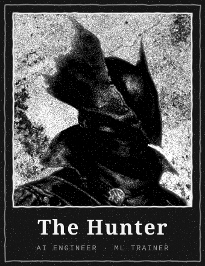
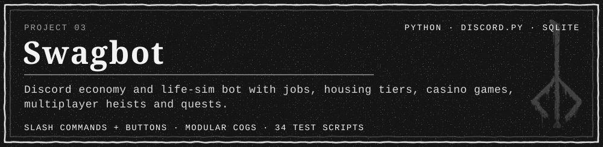

  

  

---

<h2 align="center">About Me</h2>

Hey, I'm **R. Krishothaman**, an AI/ML engineer.

I like building things with machine learning, from retrieval and LLM apps to models that understand video, and I care about testing whether they actually work.

Outside of that I build Discord bots and pick up whatever looks interesting next.

 

---

<h2 align="center">Projects</h2>

  

  

  

---

<h2 align="center">Tech Stack</h2>

  

  Also: Hugging Face Transformers · Ollama · ChromaDB · discord.py · SQLite

---

<h2 align="center">Connect</h2>

  &nbsp;&nbsp;
  

---

<h2 align="center">GitHub Stats</h2>

  

  

