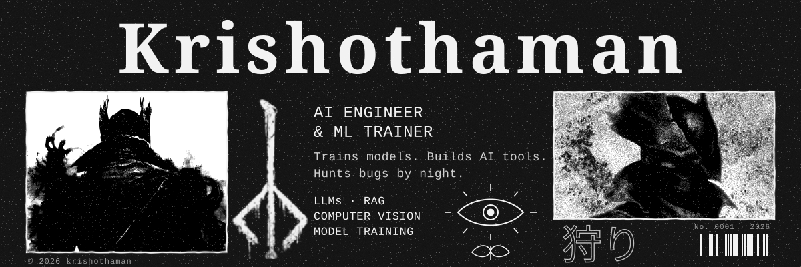
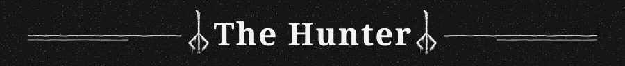
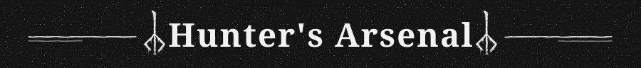
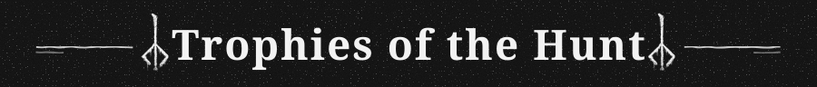
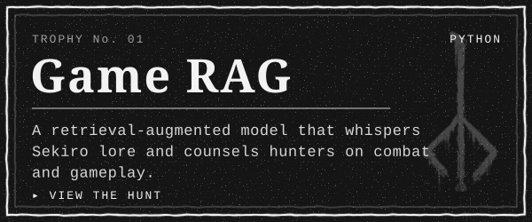
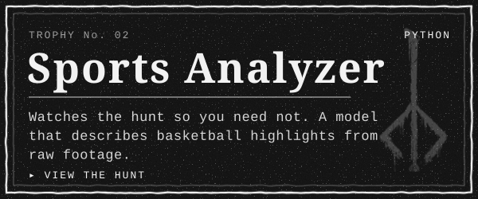

  

  

  
  
  

  
  
  

 

<table>
  <tr>
    <td width="62%" valign="top">
      
I'm <b>R. Krishothaman</b>, an <b>AI engineer and ML trainer</b>. I spend my nights in the Hunter's Dream: training models, building retrieval pipelines, and teaching machines to see.

      

        🩸 <b>AI Engineering</b>: LLM apps and RAG pipelines 
        🕯️ <b>ML Training</b>: fine-tuning, evaluation, datasets 
        👁️ <b>Computer Vision</b>: sports highlight analysis 
        🗝️ <b>Side quests</b>: Discord bots, Unreal Engine, Rust
      

      <blockquote><i>"Hesitation is defeat."</i></blockquote>
    </td>
    <td width="38%" align="center" valign="middle">
      
    </td>
  </tr>
</table>

  <b>LANGUAGES</b> 
  

  <b>AI / ML</b> 
  

  <b>TOOLS</b> 
  

  
  

  

  
  

  

  

