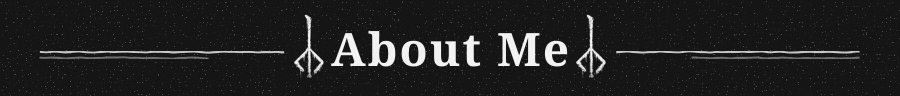
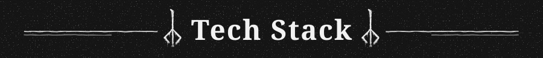
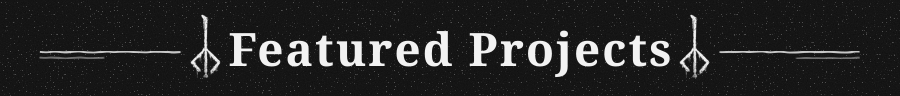
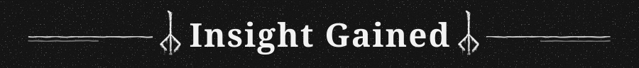
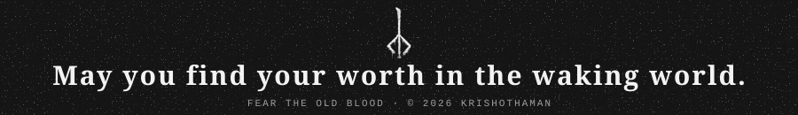

  

  

  
  
  

  
  
  

 

<table>
  <tr>
    <td width="62%" valign="top">
      
I'm <b>R. Krishothaman</b>, an <b>AI/ML engineer</b>. I train models, build retrieval pipelines, and teach machines to see.

      

        🩸 <b>AI Engineering</b>: LLM apps and RAG pipelines 
        🕯️ <b>Model Training</b>: fine-tuning, evaluation, datasets 
        👁️ <b>Computer Vision</b>: sports highlight analysis 
        🗝️ <b>Side quests</b>: Discord bots, Unreal Engine, Rust
      

    </td>
    <td width="38%" align="center" valign="middle">
      
    </td>
  </tr>
</table>

  <b>LANGUAGES</b> 
  

  <b>AI / ML</b> 
  

  <b>TOOLS</b> 
  

  
  

  

  
  

  

  

